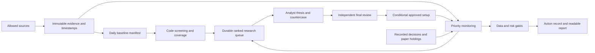

# EGX v5 — Phase 2 research and design checkpoint

**Date: 23 October 2026, Africa/Cairo. Status: design complete; implementation and trading validation not started in this phase.**

The recommended system is a daily, evidence-driven research engine with fast targeted monitoring. Its first strategy candidate is liquid-stock trend/breakout research, supported by company analysis, sector context and explicit portfolio constraints. A screen match is a research lead. An approved thesis is conditional. A priced action requires current execution evidence.

Scheduled reviews remain paused. This package does not change production rules, create investment approvals, reopen the October experiment, or authorize a new paper week. The earlier EGP 20,000 experiment is historical; new starting capital and risk parameters belong in the Phase 3 plan.

## Read this package

- [Capabilities and market-rule verification](CAPABILITIES-AND-RULES.md): live TradingView tests, coverage, official-source checks and unresolved constraints.
- [Data dictionary and fallback policy](DATA-DICTIONARY.md): every one of the 43 scanner fields plus additional research, execution and evaluation requirements; exact consequences and formulas.
- [Strategy research and analytical design](MODEL-RESEARCH.md): five model families, source evidence, suitability, economic analysis and comparison protocol.
- [Machine-readable dictionary](data-dictionary.json): proposed contract, not installed policy.
- [Evidence and validation manifest](validation.json): generated after document checks.
- [Phase 1 post-mortem](../v5-phase1-20261023/POST-MORTEM.md): measured failures this design addresses.

## What the evidence changes

Today's scanner returned **294 symbols**, versus 296 in the stored catalog; HALN and RMTV were absent from this response. That is a reconciliation issue, not proof of delisting. Daily, weekly and minute chart reads worked. The four successful daily samples included SAIB, a USD security with its latest bar on 15 September: successful retrieval is not proof of current or eligible data.

The scanner has meaningful fundamentals, indicators and consensus data, but coverage differs sharply: technical ratings on 262 symbols, P/E on 62, and usable analyst consensus on 49. TradingView also exposes a dated COMI filings inventory. The sampled document view displayed an explicitly AI-generated Quartr summary; its original PDF body was not verified. These are different evidence classes.

The official EGX beta disclosure feed and an individual announcement detail loaded successfully. A linked legacy PDF did not load through the web reader. Replace the blanket “EGX portal blocked” assumption with route-level health and document-level verification. Current official tick, band and session specifications remain unresolved; provider metadata alone cannot certify them.

The previous failure was not that every stock received thorough research and nothing qualified. There were 3,552 mechanical NO-TRADE rows, 16 current Wait decisions at the experiment cutoff, missing evidence, incomplete checkpoints and no fills. The new reporting must expose research backlog, data blockers, rejected setups and untriggered approvals separately.

## Changes from the brief, and why

| Brief assumption | Proposed correction |
|---|---|
| Old Notion ledger, broker universe and excluded providers | Build on the current local Tracker, SQLite evidence and allowed primary sources. Ignore the legacy setup as requested. |
| Collect everything every morning | Assemble one daily baseline manifest from reusable, versioned components. Collect only due deltas; issuer financials are event/filing driven. Full history backfill is a separate resumable maintenance job. |
| Every unavailable field gets a penalty | Critical fields cannot be bypassed. Optional fields can be omitted. Important, noncritical gaps use an explicit degraded route, not invented values or arbitrary “confidence points.” |
| All analysis must finish in minutes | Monitoring and reporting have hard deadlines. Deep research persists across runs until complete; its depth is not cut to meet a token or clock target. |
| 14:35 is an end-of-day signal | Treat it as provisional with the observed 15-minute delayed feed. Finalize relative to the verified session close, actual delay and a safety buffer. |
| Three reviews are sufficient for trading | Three snapshots are useful user reports, but insufficient for timely stop monitoring. Continuous operation or an explicit observation-only limitation is required for any future intraday pilot. |
| A market shock requires full re-fetch | A shock triggers a cached re-screen and event review. Re-fetch only invalidated data; an outage must not create a full-universe retry storm. |
| Zero trades means failure | Missing or unexplained decisions is an operational failure. Zero trades can be valid when the prepared system finds no qualifying setup; trade count is never an optimization target. |
| More indicators mean stronger evidence | Correlated indicators are one technical family. Demand distinct business, event, price, liquidity and risk evidence. |
| Four enhancements are entirely absent | Parts already exist in analysis/scout modules. Integrate and validate them; do not create duplicate parallel engines. |

## Tiered architecture

This is a proposed boundary between components. The diagram is not evidence that the new pipeline has been implemented.

### Tier 0: cached baseline

Build a manifest at **08:00 Cairo on an exchange session day**, ahead of the proposed 09:00 review. Include the latest *completed exchange session*, not a requirement that bars be dated today. On Friday, before the open, or after midnight, a previous valid session may be the correct baseline. A fresh capture cannot make an old bar current.

Use one daily scanner facts request, daily history deltas where absent, daily benchmark updates, and daily source-health checks. Reconcile the full catalog weekly and on official listing events; compare daily scanner membership without deleting disappeared securities. Preserve ISIN, ticker aliases, currency, segment, effective dates and eligibility status. All recorded decisions remain in the monitoring universe even when absent from the scanner.

Reuse financial statements until a new filing, revision or expected-publication deadline. “Checked today” and “financial period” are separate fields. Check disclosure/news deltas throughout the day; overnight material events invalidate affected research before the open.

Each component receives one of: verified-current, verified-prior-session, stale, partial, unavailable, conflicted, or not-applicable. The baseline can be partial. A missing optional company metric must not disable unrelated securities. A missing market calendar or global integrity failure can disable new action approval across the run.

Budget: **30 minutes hard**, target 25 minutes or less. This is grounded in the prior approximately 19.4-minute 294-symbol chart collection, not a claimed future benchmark. Large initial backfills are chunked maintenance, outside the intraday budget. Prioritize existing holdings, expiring approvals and recorded decisions before unreviewed catalog history. Publish the manifest and resumable remainder at deadline.

### Tier 1: deterministic screen

Run once after baseline assembly; **2 minutes target, 5 minutes hard**. Use local calculations and explicit validity masks. Output eligible, filtered, insufficient-data and queued counts with denominators. Rank previously unreviewed candidates and event-driven reassessments. Do not turn a low rank into an analyst Avoid verdict.

Retain separate ranks for price opportunities and quality/value opportunities so sparse financial coverage does not masquerade as bad company quality. Each strategy uses its own mandatory fields; a company may be eligible for technical research but ineligible for a value thesis.

Re-screen cached data on: a new completed-session baseline, a material new filing/action, an approved policy version change, or a declared market shock. Shock candidates for Phase 3 include a verified exchange interruption or a two-ATR benchmark move relative to the prior baseline; these are design hypotheses, not activated triggers. Each event key is idempotent. A provider outage triggers repair of affected partitions, not a market-wide re-import.

### Tier 2: targeted reviews and monitoring

The requested **09:00, 10:45 and 14:35 Cairo** times become report checkpoints, conditional on official calendar verification. The first is preparation; the last is provisional with delayed data. A final checkpoint is scheduled at **verified close + actual feed delay + 30 minutes**, rather than a permanently hardcoded 15:15. The current provider metadata would yield 15:15 on an ordinary 14:30-close day; that timing is not yet exchange-certified.

Per checkpoint: **5 minutes target, 8 minutes hard**, with report-writing reserved inside the final minute. Priority order:

1. Existing positions: exits, corporate actions, stale marks, settlement and concentration.
2. Approved setups: invalidations, trigger state, expiry and price/liquidity evidence.
3. Material issuer events, all due recorded-decision reviews, and newly triggered candidates.
4. Other ranked research leads.

Every assigned position/candidate receives an action or explicit blocked/deferred disposition before the deadline. Unprocessed candidates get NO-TRADE with RESEARCH_PENDING or DEADLINE_DEFERRED, not a fabricated rejection. For a held position with no observable price, retain the position accounting but flag HOLD/UNOBSERVABLE and urgent risk attention; do not assert safety or invent an exit fill.

Every run also evaluates the full recorded-decision index, including Wait, Avoid and superseded decisions, for fresh events, invalidations and mature outcomes. This lightweight obligation check is separate from repeating every original research report. Deep reassessment is routed only when triggered; any uncovered decision is counted and reported explicitly.

The data lane can check approved setups/positions every five minutes during a verified session in a future pilot. A 15-minute delayed feed still makes this **delayed observation**, not live execution. No “early” or real-time responsiveness claim is justified. Full-universe cheap disclosure/event feeds stay active so targeted monitoring does not miss news outside yesterday's shortlist. If such a feed cannot demonstrate continuity, run scheduled primary-source sweeps for held/approved names and report the uncovered universe explicitly.

### Deep research lane

No token budget and no forced analytical shortcut. Supply a compact evidence index, changed facts, relevant document pages and context IDs; retain full logs locally. Analysts expand sources where needed, reconcile contradictory facts, calculate scenarios and document uncertainty. Checkpoint work at least every ten minutes and when a material section completes.

Resume existing claims before new handoffs. Keep at most five unfinished handoffs; count actual unfinished work, not all future Wait conditions. A future-dated conditional revisit is a scheduled item, not a permanently active claim. Drain ranked same-session candidates in batches as capacity clears. Persist ticker, priority, last useful progress, blocking field, next attempt, evidence snapshot, owner lease and due trigger. A waiting symbol cannot starve the universe.

Separate analyst review from final review. The final reviewer tests the strongest countercase, missing evidence and action feasibility. Fresh thesis-changing evidence returns through research. Deterministic checks enforce identities, chronology, calculations and limits. Agent agreement is not independent statistical evidence.

### Reliability and time limits

Use a single chart-collector lease, owner/fencing token, heartbeat, cancellable per-request timeout and whole-job deadline. Retry transient failures at most twice with backoff inside the same deadline. Never kill a competing collector or steal an active lease. A stalled lease must be reconciled against the actual owner before recovery.

Use short database transactions, atomic checkpoint writes, append-only decision history, and idempotent event/decision keys. A crash after report creation but before ledger acknowledgement must not duplicate a decision. An interrupted run remains interrupted/stalled until explicit recovery; actual timestamps are preserved.

The existing hourly wakeup guard is not an always-on scheduler. Uptime, machine sleep, credentials and usage interruptions are engineering dependencies. Before Phase 5, demonstrate scheduler availability on the actual host or choose a reliable deployment. Do not backfill missed market observations after waking.

## Decision, action and reporting contracts

Keep research decisions (Watch / Wait / Avoid) distinct from proposed actions (BUY / SELL / HOLD / NO-TRADE). A Watch never bypasses execution checks. SELL applies only to an existing, authorized position; HOLD is not appropriate for an unowned candidate.

Each action record includes:
- Run/phase, policy and baseline IDs; decision time, source times, delay and validity expiry.
- Instrument identity/currency, ownership state and research decision/report IDs.
- Action, reason codes, strongest supporting and contradicting facts, scenario range and explicit uncertainty.
- Entry zone, invalidation, stop/exit logic, target/time horizon and cost-adjusted reward/risk where applicable.
- Quantity calculation, portfolio before/after exposure, settlement/cash checks and fill eligibility.
- Every missing field, attempted fallbacks, selected proxy, consequence, escalation owner and next review.
- Proposed action separately from observed simulated fill; unavailable or stale mark labels.

No calibrated probability is claimed until out-of-sample forecasts support it. Missing inputs reduce evidence coverage, not an invented probability of success. Store the original forecast with a horizon and measurement rule; append revisions separately.

Within one minute of each checkpoint finishing, show a short readable report: actual start/end and deadline status; baseline session; positions and monitoring coverage; candidate decisions; fresh events; blocks and backlog; cash explanation; paper P&L only from the isolated applicable ledger. An empty candidate set gets an explicit run-level NO-TRADE with counts. No decision record, unexplained gap, missed report, or silent monitoring omission is a failure.

Cash is decomposed into required reserve, pending/unsettled funds, rejected setups, approved but untriggered setups, and unfinished research/data. Do not count all idle cash as risk reserve. Never present unreviewed companies as researched.

## Four enhancements: integration priority

| Enhancement | Existing starting point | Proposed implementation/validation |
|---|---|---|
| Concentration and liquidity controls — highest | Portfolio scenario/risk calculations and paper limits exist | Enforce whole-portfolio gates, sector/issuer/group/FX exposure, pending-order cash and liquidity participation. Correlation is supplemental; absent correlation does not remove hard caps. |
| Peer benchmarking | Scout has industry P/E/ROE comparisons; analysis panels exist | Verify comparable accounting periods and business models; exclude invalid denominators, negative-equity P/B and bank/non-bank pooling. Require five valid comparable peers or label insufficient. |
| Macro-regime awareness | Macro and transmission records exist | Refresh official events; link rates/FX/inflation to each company's revenue, inputs, debt and valuation. Keep measurable trend/breadth state separate from subjective macro narrative. |
| Liquidity-tier RV20 | Current screen uses a fixed threshold | Test tier-aware volume surprise alongside the fixed threshold; keep absolute turnover, active-session and impact gates. Do not relax minimum liquidity to manufacture signals. |

All four belong in the design and planned build. Concentration protection precedes ranking improvements. Adaptive threshold learning, a predictive regime classifier and model-weight changes remain later research; they are not prerequisites for the first honest pilot.

## Acceptance design handed to Phase 3

### Integration with the existing Tracker

| Existing component | Proposed Phase 4 change |
|---|---|
| `app/refresh-selection.mjs` and `app/refresh-market.mjs` | Session-aware due selection, component manifests, bounded jobs, priority deltas and resumable history repair |
| `app/scout-efficient.mjs` | Separate cached screen from research completeness; durable ranked queue and non-starving future review items |
| `app/scout-handoff.mjs` and `app/promotion-policy.mjs` | Versioned evidence contracts and conditional field requirements; retain guarded independent approval |
| `app/analysis-market.mjs` and `app/analysis-risk.mjs` | Reuse sector/regime and portfolio calculations, add coverage/provenance checks and validate assumptions |
| `app/decision-monitor.mjs` and `app/decisions.mjs` | Complete recorded-decision obligation index, immutable forecasts and event-triggered reassessment |
| `app/operations.mjs` and `app/operations-agent.mjs` | Whole-run deadlines, explicit partial outcomes, ownership recovery and readable progress |
| `app/decision-execution.mjs`, `app/paper.mjs` and `app/paper-performance.mjs` | New experiment/version boundaries, consistent action/fill distinction, verified costs and aligned performance |
| `app/public/operations.js` and existing decision/paper views | Concise run summaries, evidence gaps, coverage/backlog and proposed-action versus fill visibility |

These are extension points, not edits made in this phase. New schema/policy versions must preserve old records and the completed experiment, with migration tests before activation.

The frozen test plan must specify exact thresholds, candidate strategy variants, capital, fees, slippage, settlement, entries and exits before observing scored outcomes. Proposed engineering acceptance criteria:

- 100% of held positions and approved setups accounted for at each scheduled checkpoint; zero silent omissions.
- 100% of considered candidates have an explicit disposition and gap handling record.
- Target deadlines measured separately from hard deadlines; every overrun publishes a partial report and durable remainder.
- No future information, stale execution data, identity/currency mismatch, duplicate action or risk-limit breach accepted.
- Full catalog coverage/backlog counts reconcile; fresh evidence does not depend on a changed screen score.
- Replay determinism holds for the same evidence/policy; restart and lease tests do not duplicate or lose work.
- Every external data failure produces a bounded retry and explicit local result; a global failure blocks new approvals while retaining visible position risk.

Fault cases must include stale-but-successful SAIB-like history, HALN/RMTV-like membership loss, missing versus zero volume, gapped minutes, split/rights adjustments, unknown price bands, tick-boundary crossings, delayed news, pending settlement, contradictory statements, missing sector, limit-locked exits, concurrent claims, partial baselines, sleep/resume and deadline exhaustion.

These are acceptance proposals, not tests performed on a new implementation. Phase 1's 106 passing existing tests do not validate v5. Phase 2 only probes available sources and validates this package's completeness.

## Checkpoint: findings, open questions and risks

**Found:** substantially more useful TradingView capability than charts alone; sharply uneven coverage; a functioning official disclosure route; stale/foreign-currency history that requires explicit validation; a workable route to targeted analysis rather than repeated bulk research.

**Changed:** component-level caching, session-aware freshness, conditional data requirements, bounded monitoring with unbounded resumable deep research, genuine thesis/countercase review, and explicit partial coverage. These are proposed changes documented here, not production edits.

**Still unresolved before realistic execution testing:** authoritative effective session/auction schedule, security-specific ticks/bands and halt status, complete cost/tax applicability, reliable original-disclosure ingestion, and the chosen account's settlement/eligibility assumptions. No unsupported default will silently pass these gates.

**Phase 3 choices:** new paper capital/risk authorization; exact strategy and baseline; risk/exit parameters; delayed-data paper methodology versus a verified real-time entitlement; benchmark series and evaluation horizons. They do not prevent completing Phase 2.

**Risks:** current-catalog survivorship, revised historical fundamentals, limited minute history, asynchronous prices, thin trading, price-limit queues, vendor endpoint changes and local-machine uptime. A profitable short test cannot establish an edge; a zero-trade test cannot establish that all companies were analyzed.

Stop here for the requested Phase 2 review. Keep automation paused until the workflow is prepared and explicitly resumed.

